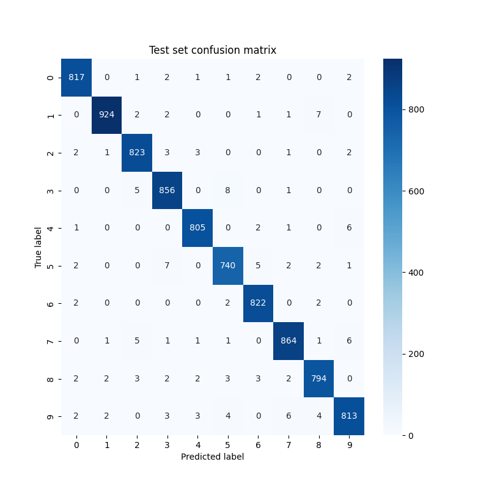
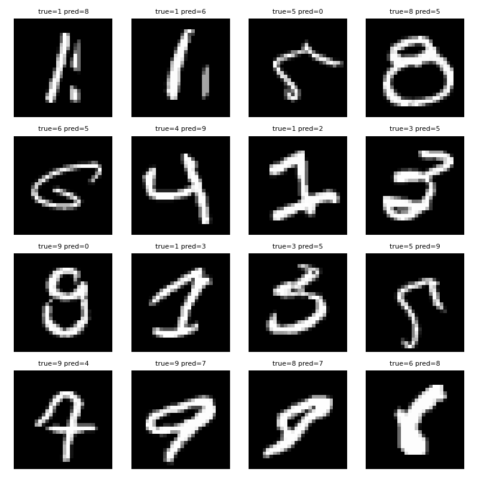
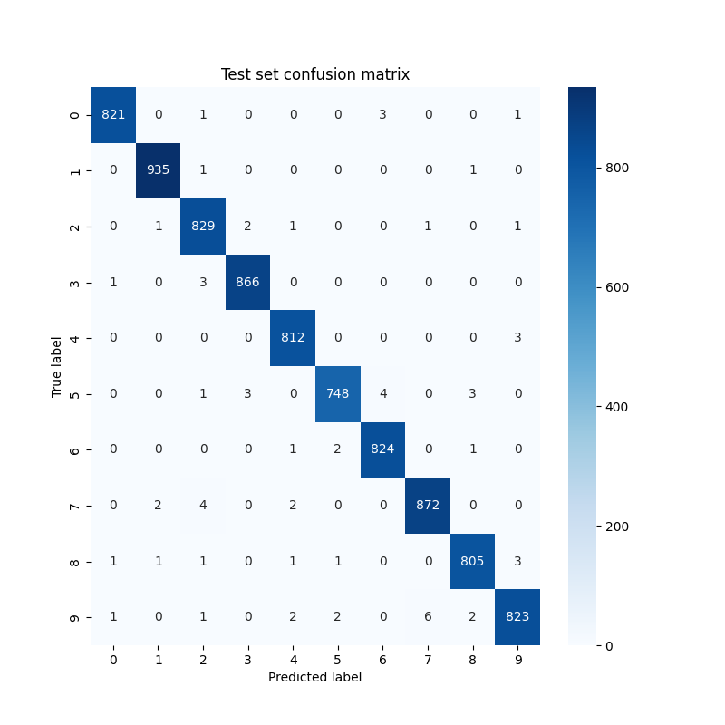
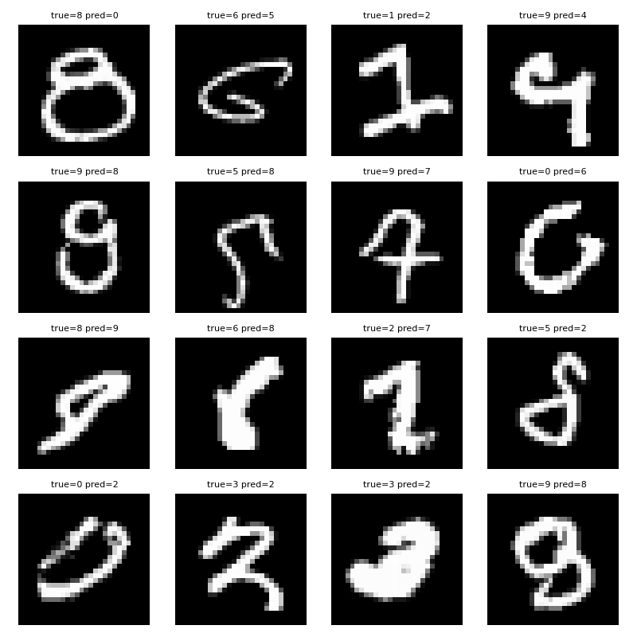
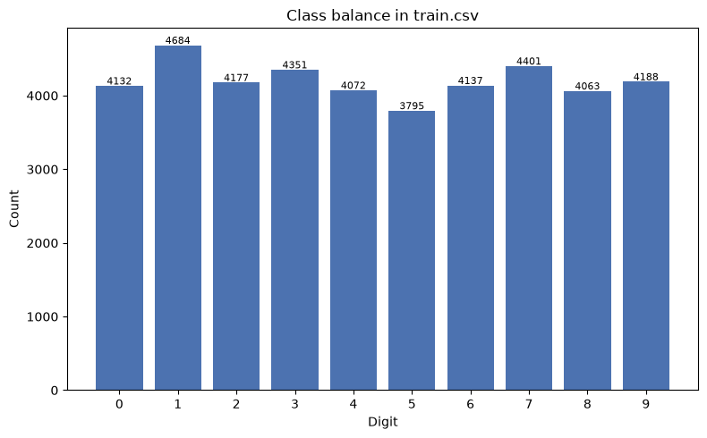
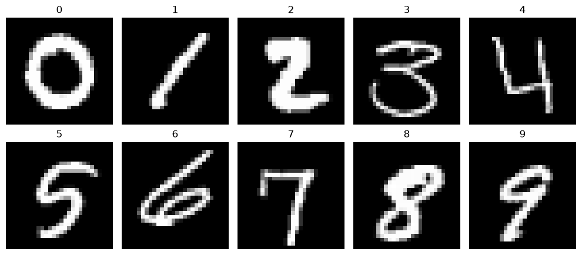
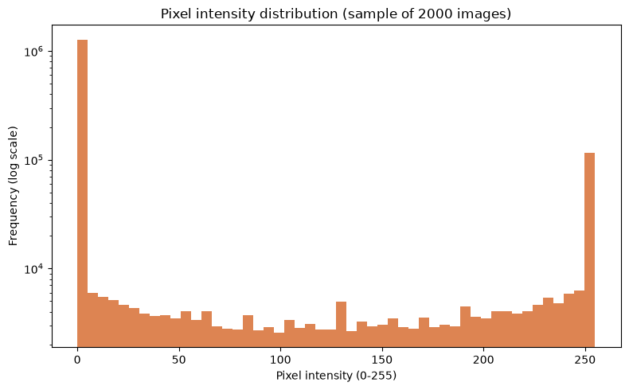
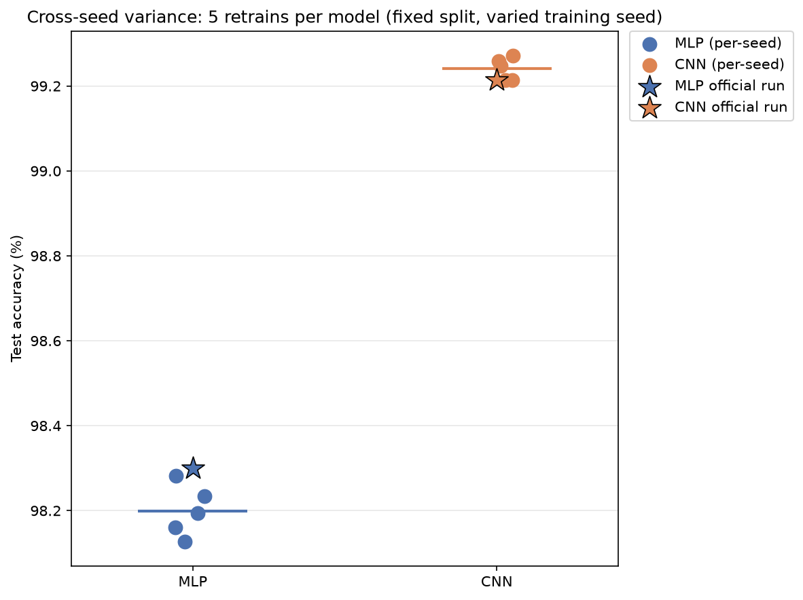
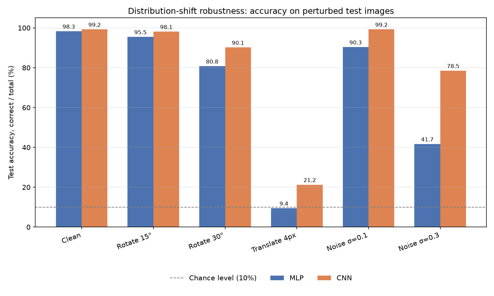

# MNIST Digit Classification — MLP, and a CNN Comparison

[](https://github.com/ivannamor/mnist-digit-classification/actions/workflows/ci.yml)

A PyTorch Lightning pipeline for the Kaggle "Digit Recognizer" (MNIST) dataset, built for the Deep Learning Fundamentals project. Covers data cleaning, a stratified train/val/test split, a configurable MLP architecture, a systematic hyperparameter search, and a final held-out test evaluation. The required deliverable is the MLP; a CNN was added afterward as a stretch-goal comparison, built and searched the same rigorous way.

## Results

| | Validation accuracy | Test accuracy | Test precision | Test recall |
|---|---|---|---|---|
| MLP baseline (`configs/baseline.yaml`) | 97.19% | — | — | — |
| **MLP best** (Optuna search, `configs/best_from_search.yaml`) | 98.12% | 98.30% | 98.29% | 98.30% |
| CNN baseline (`configs/cnn_baseline.yaml`) | 98.71% | — | — | — |
| **CNN best** (Optuna search, `configs/cnn_best_from_search.yaml`) | 99.22% | **99.21%** | 99.22% | 99.21% |

The CNN's *un-tuned baseline* (98.71%) already beats the MLP's *fully tuned best* (98.12%) — a direct illustration of why architecture matters more than hyperparameter tuning here. The fully-tuned CNN roughly halves the MLP's error rate (1.70% → 0.79% of test digits misclassified).

The test set was evaluated exactly once per model, after each model's best configuration was already selected from validation results — never used for any model or hyperparameter decision. Both models use the identical stratified split (same seed, same data), so the comparison is apples-to-apples.

### MLP

**Confusion matrix** (test set):



**Sample misclassified digits**: most of these are genuinely ambiguous even to a human eye (e.g. a looping "1" that reads as "8", a "9" that reads as "0") — a sign the remaining errors are close to the ceiling of what a flattened-pixel MLP can resolve, rather than a systematic model weakness.



### CNN

**Confusion matrix** (test set):



**Sample misclassified digits**: again, dominated by genuinely ambiguous handwriting rather than a systematic weakness.



## Quickstart

Requires Python 3.11+. A GPU is optional: evaluating the included checkpoints takes about a minute on CPU.

```bash
git clone https://github.com/ivannamor/mnist-digit-classification.git
cd mnist-digit-classification
python -m venv .venv
source .venv/bin/activate          # Windows: .venv\Scripts\activate
pip install -r requirements.txt
```

**Kaggle data access** (one-time). The data is downloaded automatically on first run, which needs a Kaggle API token:

1. Accept the rules of the [Digit Recognizer](https://www.kaggle.com/competitions/digit-recognizer/rules) competition (otherwise the download returns 403).
2. Create an API token under *Settings → API* on kaggle.com.
3. `cp .env.example .env` and paste the token into `KAGGLE_API_TOKEN`.

Alternatively, download `train.csv` manually from the competition page and place it at `data/train.csv` — no token needed.

**Reproduce the headline result** from the included checkpoint (no training):

```bash
python -m src.evaluate --config configs/cnn_best_from_search.yaml --checkpoint results/cnn_best_from_search.ckpt --output-dir outputs/evaluation_cnn
python -m src.evaluate --config configs/best_from_search.yaml     --checkpoint results/mlp_best_from_search.ckpt --output-dir outputs/evaluation_mlp
```

Each prints test accuracy/precision/recall (expected: CNN 99.21%, MLP 98.30%) and writes its confusion matrix and misclassified-examples plots to the given `--output-dir`.

**Train from scratch, or rerun the hyperparameter search:**

```bash
python -m src.train  --config configs/cnn_best_from_search.yaml      # best checkpoint saved under outputs/logs/
python -m src.search --config configs/cnn_baseline.yaml --n-trials 20
```

Any YAML in `configs/` works with all three commands; `architecture: mlp | cnn` selects the model. The cross-seed and distribution-shift experiments are run from `notebooks/kaggle_robustness.ipynb` (functions in `src/robustness.py`).

**Run the tests:**

```bash
pip install -r requirements-dev.txt
pytest                       # full suite, ~30s on CPU
pytest -m "not regression"   # skip the real-data check
```

The suite runs offline on a small synthetic dataset in Kaggle's CSV format, so it needs no data download or GPU. It covers data cleaning, train/val/test disjointness and stratification, model shapes, checkpoint save/load, every config file and search-space choice, and a short training run through each entry point. One extra regression test evaluates the committed checkpoints on the real data and checks they reproduce the results table above exactly; it runs only when `data/train.csv` is present and is skipped otherwise.

## Data

Source: Kaggle's [Digit Recognizer](https://www.kaggle.com/competitions/digit-recognizer) competition. Its `test.csv` has no labels (it exists for leaderboard submission only), so the full train/validation/test split (60/20/20, stratified) is built entirely from the 42,000-row `train.csv`.

Cleaning checks performed: missing values, exact duplicate rows, pixel values outside [0, 255], label values outside [0, 9], blank (all-zero) images. On this dataset all counts came back zero — it's already clean — but the checks are kept in the pipeline as guardrails rather than assumed. Class balance was also verified explicitly (9.0%–11.2% per digit) rather than assumed. Full EDA, actually executed rather than just asserted, is in `notebooks/exploration.ipynb`.





Pixel intensities are heavily bimodal — mostly-black backgrounds vastly outnumber the bright stroke pixels (note the log scale) — which is why pixel values are normalized to `[0, 1]` before training rather than used as raw `[0, 255]` integers.



## Techniques used, and why

- **PyTorch Lightning** over raw PyTorch — removes GPU-handling and training-loop boilerplate, and gives callbacks (`ModelCheckpoint`, `EarlyStopping`, `LearningRateMonitor`) and `torchmetrics` integration for free.
- **Config-driven, multi-architecture design** (`ExperimentConfig` dataclasses, loaded from YAML). An `architecture: mlp | cnn` field selects both the model config dataclass and the `LightningModule` subclass (`build_model(config)` / `load_model(config, ckpt_path)`). The data module always yields un-flattened `(1, 28, 28)` tensors — flattening happens inside `MLPClassifier.forward()`, not the data loader — which is exactly why adding the CNN later required zero changes to data loading, cleaning, or splitting: only a new model class and config.
- **A shared `BaseClassifier`** holds the training/validation/test-step and optimizer logic common to both architectures; `MLPClassifier` and `CNNClassifier` only differ in `_build_net`/`forward`. Avoids duplicating ~70 lines of near-identical Lightning boilerplate across two model classes.
- **Optuna over manual grid search** — the brief asks for comparisons across 7+ hyperparameter dimensions (optimizer, batch size, activation, learning rate, dropout, architecture, loss); a full grid over that space is combinatorially impractical. Optuna samples the space and uses past trial results to guide future trials, rather than searching blindly. Run independently for the MLP and the CNN, each with its own architecture-specific search space (`search.py` dispatches on `config.architecture`).
- **Stratified splitting** (`sklearn.train_test_split`, `stratify=y`, twice — train vs. rest, then val vs. test) — preserves class balance across all three partitions.
- **Fixed random seeds** (`pl.seed_everything`, plus a fixed split seed) — so differences between experiments reflect the hyperparameters (or architecture) being compared, not split/init noise.
- **`torchmetrics`** for accuracy/precision/recall/confusion matrix — computed natively inside Lightning's `validation_step`/`test_step`, avoiding hand-rolled metric bookkeeping.
- **Macro-averaged precision/recall**, not just accuracy — accuracy alone can be misleading under class imbalance. This dataset turned out to be balanced (verified, not assumed), but computing macro metrics regardless is the more defensible default.
- **Cached data loading** (`functools.cache` on the load-clean-split step, keyed on the parameters that actually affect the result). `setup()` was getting called ~54 times across this project's baseline/search/retrain/cross-seed runs, most of them within the same process — measured locally, a cold load took 4.65s, a cached one ~0s, with array-identical results.

### The winning configurations, and what they say

**MLP**: `hidden_dims=[512,256]`, `activation=gelu`, `optimizer=adamw`, `dropout≈0.26`, `weight_decay≈0.00043`, `label_smoothing=0.1`, `batch_size=128`. Three regularizers together — consistent with it training the full 30 epochs without early stopping (regularization slows convergence) while generalizing better than the baseline.

**CNN**: `conv_channels=[64,128]`, `kernel_size=3`, `fc_hidden_dim=256`, `activation=gelu`, `optimizer=adam`, `dropout≈0.015`, `weight_decay≈0.00002`, `label_smoothing=0.1`, `batch_size=64`. Notably, both regularization strengths (dropout, weight decay) are roughly 15-20x *smaller* than the MLP's — consistent with CNNs already having a strong built-in regularizer via weight sharing (the same small filter reused across the whole image means far fewer independent parameters relative to representational capacity than a dense layer), so less explicit regularization was needed to generalize well.

Both winning configs converged on `activation=gelu` and `label_smoothing=0.1` independently — some evidence these help regardless of architecture, for this problem. Since both use the same `label_smoothing`, their `test_loss` values (MLP 0.555, CNN 0.531) are directly comparable to each other, unlike the within-model baseline-vs-search comparisons (where `label_smoothing` differs and so loss values aren't comparable — only accuracy/precision/recall are, within a model).

## Robustness checks

Beyond the single-run test accuracy above, two follow-up experiments probe whether that number is trustworthy and how far it generalizes.

### Cross-seed variance

Both winning configs were retrained 5 times each with different random initialization (`training_seed` 42–46), keeping the data split fixed so every retrain is evaluated on the identical test set. This isolates "how much does the number move around due to random init/shuffling alone" from split luck.



| | Mean test accuracy | Std dev | Range |
|---|---|---|---|
| MLP | 98.199% | 0.061pp | 98.127% – 98.282% |
| CNN | 99.241% | 0.027pp | 99.214% – 99.272% |

Both models are stable — well under a quarter of a percentage point of spread — so the headline numbers aren't a lucky single run. The CNN is also *more* consistent run-to-run than the MLP (roughly half the standard deviation), on top of being more accurate. One curiosity worth naming honestly: the CNN's `training_seed=42` rerun reproduced its original result bit-for-bit; the MLP's did not, despite "the same seed" in both cases. `pl.seed_everything` seeds the RNGs but doesn't force bit-identical GPU execution (cuDNN kernel scheduling has some inherent floating-point non-determinism unless `torch.use_deterministic_algorithms` is explicitly forced) — worth knowing precisely rather than assuming "same seed" means "same result" on GPU.

### Distribution-shift evaluation

The already-trained models (no retraining) were evaluated on perturbed versions of the test set — rotation, translation, and Gaussian noise — to check generalization beyond MNIST's own narrow, curated distribution.



| Perturbation | MLP | CNN |
|---|---|---|
| Clean | 98.31% | 99.23% |
| Rotate 15° | 95.46% | 98.10% |
| Rotate 30° | 80.76% | 90.14% |
| Translate 4px | **9.42%** | **21.24%** |
| Noise σ=0.1 | 90.31% | 99.15% |
| Noise σ=0.3 | 41.73% | 78.43% |

The CNN degrades more gracefully than the MLP under every perturbation, most dramatically for noise (σ=0.3: 78.43% vs. 41.73%). But the translation result is the important one to interpret carefully: a 4-pixel shift collapses the MLP to *chance level* (9.4%, vs. 10% expected from random guessing across 10 balanced classes), and the CNN — while clearly better — still falls to 21.2%, nowhere near usable. **This is not evidence that CNNs are translation-invariant and MLPs aren't** — a plain CNN's translation robustness comes only from local pooling within its conv layers; the flatten+FC head at the end has the same fixed-position assumption as the MLP does everywhere. Neither model was ever trained on shifted examples, so neither can be expected to handle a transformation it never saw — this is direct empirical support for the data-augmentation suggestion below, not a property either architecture gets for free.

## Suggestions for further improvement

- **A real pruning callback for the Optuna search.** Both searches use `optuna.pruners.MedianPruner`, but trials don't report intermediate per-epoch metrics back to Optuna, so it currently can't actually cut a clearly-bad trial short — every trial runs to its own early-stopping point regardless of how it compares to others so far. Wiring in per-epoch reporting would make a larger search (more trials, wider ranges) more efficient.
- **Wider/longer search**, especially for the CNN — 20 trials over a moderately-sized space is a reasonable first pass, not an exhaustive one. The CNN search only varied 2-layer channel widths; depth (3+ conv blocks) wasn't explored.
- **Data augmentation** (small rotations/shifts/translations) — no longer just a theoretical suggestion: the robustness check above shows both models collapse under a 4px translation (MLP to chance level, CNN to 21%) since neither was ever trained on shifted examples. Augmentation during training is the direct fix, and the CNN in particular should benefit most, since translation/rotation invariance is exactly what convolution + augmentation reinforces together.
- **Weight initialization / BatchNorm.** Not explored here (both architectures are shallow enough that vanishing/exploding gradients weren't a practical issue), but worth an ablation on a deeper CNN.
- **Transfer learning** (e.g. a small ImageNet-pretrained backbone, fine-tuned) — unlikely to help much on MNIST specifically (it's simple enough that training from scratch is standard and already near-ceiling), but would be the natural next thing to try on a harder image dataset.

## Project structure, reproducing this project

See [REPORT.md](REPORT.md) for the full write-up: every design decision, experiment, and result, plus the Kaggle-Notebooks-specific setup. In short:
- `src/` — the pipeline (data module, model, train/search/evaluate entry points), runnable locally or on Kaggle, for either architecture.
- `configs/baseline.yaml` / `configs/best_from_search.yaml` — the MLP configs behind the results above.
- `configs/cnn_baseline.yaml` / `configs/cnn_best_from_search.yaml` — the CNN configs.
- `notebooks/kaggle_train.ipynb` / `kaggle_train_cnn.ipynb` — reusable templates for a fresh Kaggle GPU run; `notebooks/kaggle_run_executed.ipynb` / `kaggle_run_executed_cnn.ipynb` — the actual executed runs with outputs intact; `notebooks/kaggle_robustness.ipynb` — the cross-seed trials.
- `src/robustness.py` — cross-seed trials and distribution-shift evaluation (`run_cross_seed_trials`, `run_shift_robustness`).
- `scripts/publish_kaggle_dataset.py` — syncs `src/`/`configs/` to Kaggle, since Kaggle Notebooks have no direct access to this local filesystem.
- `tests/` — pytest suite (see *Run the tests* above); `tests/conftest.py` builds the synthetic dataset, `tests/test_regression.py` is the real-data check against the results table.

## License

The code and the trained checkpoints in `results/` are released under the [MIT License](LICENSE). The MNIST data is not included in this repository: it is downloaded from Kaggle's [Digit Recognizer](https://www.kaggle.com/competitions/digit-recognizer) competition and remains subject to that competition's terms.
