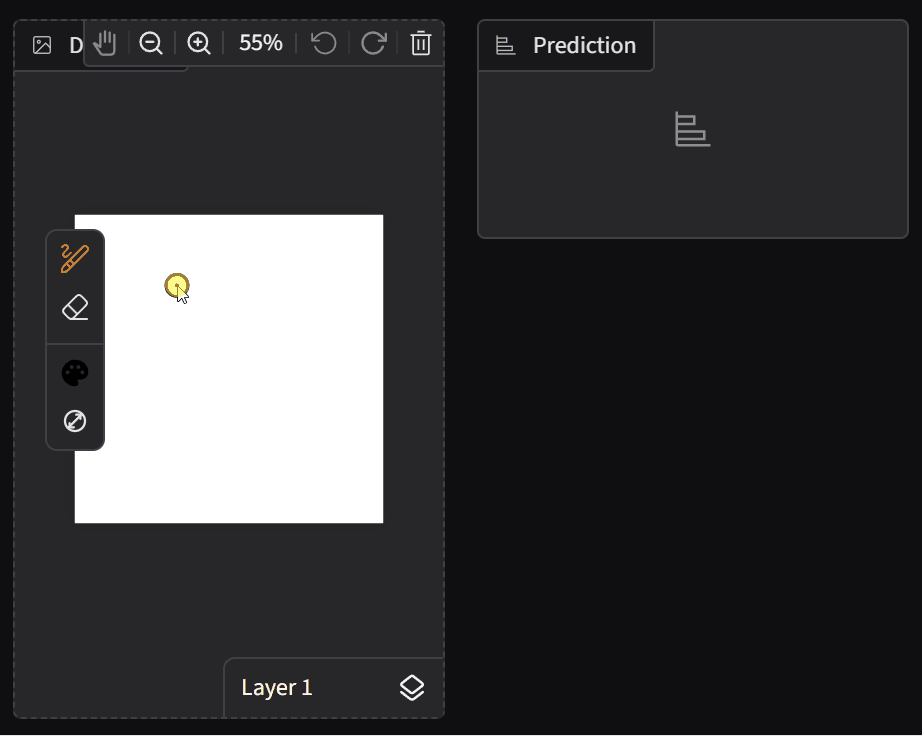
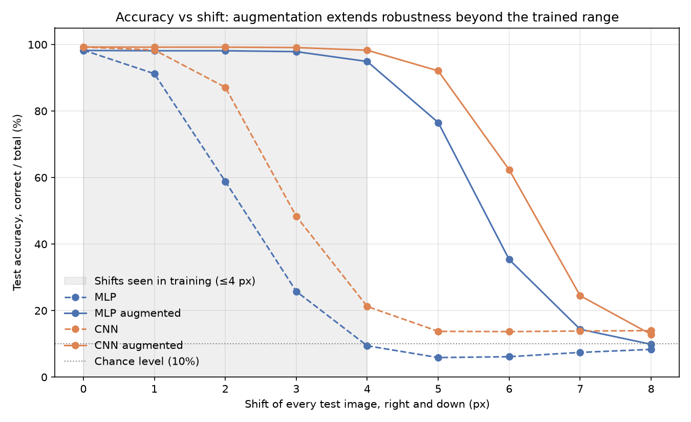

# MNIST: MLP vs CNN — Tuning, Seed Variance and Robustness Under Distribution Shift

[](https://github.com/ivannamor/mnist-digit-classification/actions/workflows/ci.yml)

An end-to-end PyTorch Lightning project on the Kaggle "Digit Recognizer" (MNIST) data, built around evaluation you can trust: a test set touched exactly once, results that hold across 5 random seeds, robustness tests that show where both models break (a 4-pixel shift), and two fixes for it — a prediction pipeline for real-world images and data augmentation, whose trade-off is measured too. The tuned CNN reaches 99.2% test accuracy. The headline results, the robustness tables and the prediction numbers are reproducible from the committed checkpoints and pinned by regression tests.

Started as the Deep Learning Fundamentals project at Turing College, where the required deliverable was the MLP; the CNN comparison, robustness checks, tests and demo were added beyond the brief. [REPORT.md](REPORT.md) has the full write-up.



*The web demo (`python app.py`): draw a digit, and the tuned CNN predicts it live.*

**Contents:** [Results](#results) · [Robustness](#robustness) · [Predicting on real-world images](#predicting-on-real-world-images) · [Quickstart](#quickstart) · [How it's built](#how-its-built) · [Future work](#future-work) · [Project structure](#project-structure)

## Results

| | Validation accuracy (balanced) | Test accuracy (balanced) | Test precision | Test recall |
|---|---|---|---|---|
| MLP baseline (`configs/baseline.yaml`) | 97.19% | — | — | — |
| **MLP best** (Optuna search, `configs/best_from_search.yaml`) | 98.12% | 98.30% | 98.29% | 98.30% |
| CNN baseline (`configs/cnn_baseline.yaml`) | 98.71% | — | — | — |
| **CNN best** (Optuna search, `configs/cnn_best_from_search.yaml`) | 99.22% | **99.21%** | 99.22% | 99.21% |

- **Accuracy is balanced accuracy** (torchmetrics' macro averaging: the mean of the ten per-class accuracies), which is why it equals macro recall. Plain accuracy (correct ÷ total) is 98.31% and 99.23%; with near-balanced classes the two differ by at most 0.02 points.
- **The test set was evaluated exactly once per model**, after every choice was made on validation data. Both models use the identical stratified 60/20/20 split.
- The **untuned CNN baseline (98.71%) already beats the fully tuned MLP (98.12%)**: architecture matters more than tuning here. The tuned CNN makes 65 errors on the 8,400 test digits against the MLP's 142 (0.77% vs. 1.69%), mostly by fixing the 3↔5 and 1→8 confusions that convolution is built to resolve.


The remaining CNN errors are mostly genuinely ambiguous handwriting:


## Robustness

**The results are stable.** Each winning configuration was retrained with 5 different random seeds on the same split:

| | Mean test accuracy (balanced) | Std. dev. | Range |
|---|---|---|---|
| MLP | 98.199% | 0.061 pp | 98.127% – 98.282% |
| CNN | 99.241% | 0.027 pp | 99.214% – 99.272% |

**But a 4-pixel shift breaks both models.** Evaluated on perturbed test images, the original MLP falls to chance level (9.4%) and the CNN to 21.2%: both only ever saw centred digits. Retraining the same configurations with **data augmentation** (random shifts up to 4 px and rotations up to 15° on training images only, `configs/*augmented.yaml`) fixes it without costing accuracy on normal digits (test accuracy CNN 99.21% → 99.25%, MLP 98.30% → 98.21%, both within the seed spread above), and the robustness extends beyond the trained range:



**It's a trade-off, not a free win.** Re-running the full robustness suite shows rotation also improved, but heavy noise got much worse (plain accuracy, %):

| Perturbation | MLP | MLP augmented | CNN | CNN augmented |
|---|---|---|---|---|
| Clean | 98.31 | 98.21 | 99.23 | 99.25 |
| Rotate 15° | 95.46 | 96.92 | 98.10 | 98.39 |
| Rotate 30° | 80.76 | 88.57 | 90.14 | 93.54 |
| Translate 4px | 9.42 | **94.89** | 21.24 | **98.29** |
| Noise σ=0.1 | 90.33 | 70.90 | 99.23 | 91.05 |
| Noise σ=0.3 | 41.68 | **15.25** | 78.50 | **13.39** |

Under heavy noise the augmented models answer "8" for almost every image. Part of the reason is measurable: the original CNN almost completely ignores the image border, where centred digits never reach (noise only on the border leaves it at 99.0%), while the augmented CNN, trained on shifted digits, no longer does (86.4%). It is also more sensitive to noise over the digit itself (82.4% → 31.4%), which that experiment doesn't explain. The lesson: re-run the whole robustness suite after any change, not just the metric being fixed. Full tables, figures and analysis: [REPORT.md, section 12.4](REPORT.md#124-data-augmentation-experiment).

## Predicting on real-world images

A real photo or drawing doesn't look like MNIST, and the shift results show how little that takes to break a model. So `src/predict.py` first converts images the way MNIST itself was built: dark-on-light images are inverted, the digit is cropped, scaled to fit a 20×20 box (keeping its aspect ratio), and centred by centre of mass on a 28×28 canvas. On the first 1,000 real test digits redrawn as dark ink on a white 200×200 page at a random position (plain accuracy):

| | CNN | MLP |
|---|---|---|
| Original MNIST test images | 99.0% | 98.4% |
| Photo-like page, **with** this preprocessing | 98.8% | 98.4% |
| Photo-like page, naive resize + invert only | 29.4% | 14.8% |

The CLI and the web demo use the original CNN: preprocessing already handles the shift problem at prediction time, and the original copes better with noise.

## Quickstart

Requires Python 3.12+. A GPU is optional: evaluating the included checkpoints takes about a minute on CPU. Dependencies are pinned to the verified versions; [Dependabot](.github/dependabot.yml) proposes updates weekly, each tested by CI.

```bash
git clone https://github.com/ivannamor/mnist-digit-classification.git
cd mnist-digit-classification
python -m venv .venv
source .venv/bin/activate          # Windows: .venv\Scripts\activate
pip install -r requirements.txt
```

**Data.** It downloads automatically on first run with a Kaggle API token: accept the [Digit Recognizer rules](https://www.kaggle.com/competitions/digit-recognizer/rules) (otherwise the download returns 403), create a token under *Settings → API* on kaggle.com, then `cp .env.example .env` and paste it into `KAGGLE_API_TOKEN`. Or download `train.csv` from the competition page into `data/train.csv`, no token needed.

```bash
# Reproduce the headline results from the included checkpoints (expected: CNN 99.21%, MLP 98.30%)
python -m src.evaluate --config configs/cnn_best_from_search.yaml --checkpoint results/cnn_best_from_search.ckpt --output-dir outputs/evaluation_cnn
python -m src.evaluate --config configs/best_from_search.yaml     --checkpoint results/mlp_best_from_search.ckpt --output-dir outputs/evaluation_mlp

# Predict the digit in your own images (tuned CNN by default)
python -m src.predict my_digit.png          # -> my_digit.png: 9   (9: 95.4%, 1: 0.8%, 6: 0.7%)

# Regenerate every robustness table and figure
python scripts/shift_robustness.py

# Train from scratch, or rerun a hyperparameter search (any YAML in configs/ works)
python -m src.train  --config configs/cnn_best_from_search.yaml
python -m src.search --config configs/cnn_baseline.yaml --n-trials 20

# Web demo, then open http://127.0.0.1:7860
pip install -r requirements-demo.txt
python app.py

# Tests
pip install -r requirements-dev.txt
pytest -m "not regression"   # everyday check: no real data needed, ~1 min on CPU
pytest                       # full suite incl. real-data regression tests, ~7 min on CPU
```

Prediction probabilities top out around 90–95% because the models were trained with label smoothing. The test suite runs offline on a small synthetic dataset in Kaggle's CSV format; the regression tests run only when `data/train.csv` is present and check that the committed checkpoints reproduce every published number exactly.

## How it's built

- **PyTorch Lightning** with a config-driven design: every experiment is a YAML file loaded into dataclasses, and `architecture: mlp | cnn` selects the model. Images stay `(1, 28, 28)` until the MLP flattens them in `forward()`, which is why adding the CNN needed no data-pipeline changes. A shared `BaseClassifier` holds the training and evaluation logic.
- **Optuna** hyperparameter search over 8 dimensions for the MLP and 10 for the CNN (20 trials each on a Kaggle T4), with median pruning of clearly-losing trials (added after the published searches ran).
- **Stratified two-stage split** and **separate seeds** for the split and for training, so cross-seed checks vary one while holding the other fixed.
- **Macro-averaged metrics**, set explicitly rather than relying on library defaults.
- **Winning configurations**: MLP `[512, 256]`, GELU, AdamW, dropout ≈ 0.26; CNN conv `[64, 128]`, kernel 3, FC 256, GELU, Adam, dropout ≈ 0.015. Both landed on GELU and label smoothing 0.1 independently; the CNN needed 15–20× less explicit regularization, consistent with convolution's built-in weight sharing.
- **Engineering**: 135 tests (synthetic-data suite plus real-data regression tests), CI on Python 3.12 and 3.13, pinned dependencies with Dependabot, and seeded, scripted robustness evaluations.

The reasoning behind each choice, the full search spaces, per-class error analysis and the engineering problems solved along the way are in [REPORT.md](REPORT.md).

## Future work

- **Noise augmentation**: add Gaussian noise to the training augmentation and check whether noise robustness recovers without losing the shift gains.
- **Fashion-MNIST**: run the same pipeline on a harder dataset to show it generalizes beyond digits.
- **In-browser demo**: export the CNN to ONNX and run it client-side, so the demo can be hosted for free.
- **Wider search**: deeper CNNs (3+ conv blocks), and searching with augmentation on rather than retraining the existing winners.

## Project structure

- `src/` — the pipeline: data module, models, `train` / `search` / `evaluate`, `robustness` evaluations and `predict` (preprocessing and prediction for arbitrary images).
- `configs/` — `baseline` / `best_from_search` / `augmented` for the MLP, the same three with a `cnn_` prefix for the CNN.
- `results/` — the four checkpoints (original and augmented MLP and CNN) and every figure.
- `notebooks/` — the executed Kaggle GPU runs, outputs intact (training and search, cross-seed trials, augmentation) and the EDA. To rerun one, upload it to Kaggle and *Run all*.
- `scripts/` — `shift_robustness.py` (regenerates the robustness results) and `publish_kaggle_dataset.py` (syncs `src/` and `configs/` to Kaggle for the notebooks).
- `app.py` — the Gradio web demo; `docs/demo.gif` is a recording of it.
- `tests/` — the pytest suite; `tests/test_regression.py` pins the published numbers.

## License

The code and the trained checkpoints in `results/` are released under the [MIT License](LICENSE). The MNIST data is not included in this repository: it is downloaded from Kaggle's [Digit Recognizer](https://www.kaggle.com/competitions/digit-recognizer) competition and remains subject to that competition's terms.
